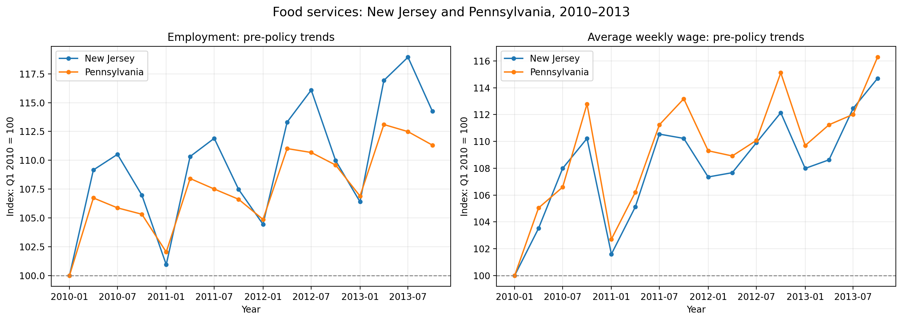
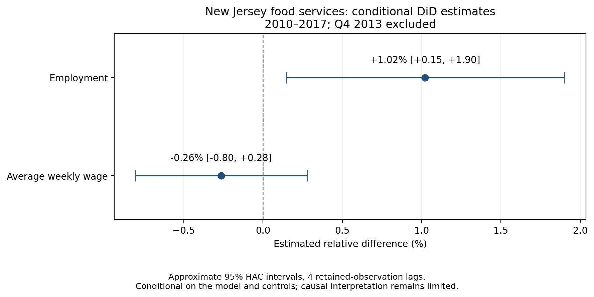

# Minimum Wage Policy, Employment, and Weekly Wages in New Jersey
## A Difference-in-Differences Analysis of Food Services, 2010–2018

## Executive Summary

This study investigates whether New Jersey’s minimum wage policy
beginning in January 2014 was associated with changes in employment
and average weekly wages in private-sector food services and drinking
places.

The analysis combines Bureau of Labor Statistics employment and wage
data with minimum wage histories published through FRED. A balanced
panel covers 50 states and Washington, DC, from 2010 through 2018.
The estimation sample uses New Jersey and five comparison states:
Pennsylvania, Indiana, Kansas, Kentucky, and Virginia.

In a specification covering 2010–2017 and excluding Q4 2013, New
Jersey’s employment increased approximately 1.02% relative to the
five-state benchmark. The approximate conditional 95% interval is
0.15% to 1.90%. The weekly wage difference is −0.26%, with an
interval of −0.80% to 0.28%.

These findings are sensitive to comparison-group choices. Using
Pennsylvania alone increases the employment estimate to 2.65%.
The weekly wage estimate changes sign when Kansas is excluded
from the pooled controls.

The study therefore identifies conditional differences rather than
establishing that minimum wage policy caused these outcomes.

## 1. Research Question and Scope

How did employment and average weekly wages in New Jersey’s
private-sector food services industry change after its January
2014 minimum wage increase, relative to comparison states?

The intervention includes the initial increase and subsequent
inflation-linked adjustments. It is not a constant $1 treatment
throughout the post-policy period.

The completed analysis focuses on NAICS 722, food services and
drinking places. Retail, unemployment, poverty, crime, and educational
attainment are outside the completed scope. The results should not
be generalized to all workers, industries, or US states.

## 2. Policy Background

New Jersey voters approved the minimum wage amendment on November
5, 2013. The general minimum wage increased from $7.25 to $8.25
per hour on January 1, 2014, an increase of approximately 13.79%.

The downloaded annual series records rates of $8.38 in 2015 and
2016, $8.44 in 2017, and $8.60 in 2018. The federal benchmark
remained $7.25 during the study window.

The approval date precedes implementation, creating a possible
anticipation period. Excluding Q4 2013 addresses one plausible
window but cannot rule out earlier responses.

Other policies complicate interpretation. Newark adopted a paid
sick leave ordinance on January 28, 2014. New Jersey’s statewide
earned sick leave law took effect on October 29, 2018. Excluding
2018 avoids the statewide implementation period but does not
remove earlier municipal policy overlap.

## 3. Data and Preparation

### Sources

Employment and wage outcomes come from the BLS Quarterly Census
of Employment and Wages (QCEW). Annual minimum wage histories
come from FRED series sourced from the US Department of Labor.

Historical QCEW data were retrieved from annual ZIP archives.
Annual minimum wage observations were used for policy screening,
rather than assumed to provide a complete quarterly legal timeline.

### Panel construction

Records were filtered to:
- The 50 states and Washington, DC.
- Private-sector ownership, code 5.
- Statewide three-digit industry records, aggregation code 55.
- Food services and drinking places, industry code 722.
- Four quarters per year from 2010 through 2018.

The resulting panel contains 1,836 observations:
51 geographic areas × 9 years × 4 quarters.

Coverage checks confirmed every expected state-year-quarter
combination, no duplicate keys, blank disclosure flags, and no
missing values in the selected outcome fields. No imputation
was required.

The six-state estimation panel contains 216 observations.
The restricted 2010–2017 sample excluding Q4 2013 contains 186
state-quarter observations, corresponding to 31 observed quarters.

### Outcome definitions

Quarterly average monthly employment was calculated as:

Employment = (Month 1 + Month 2 + Month 3 employment) / 3

This measures jobs, rather than unique workers.

Average weekly wages were retained as published by BLS. They
reflect hours, worker composition, and compensation; they are not
a direct measure of hourly wages or earnings for a fixed worker.

Both outcomes were transformed using natural logarithms.
Published wage values were analyzed in nominal dollars.

## 4. Exploratory Analysis and Control Selection

Pennsylvania was examined first because it is a neighboring
candidate with an unchanged annual wage series during the window.
Four additional states were screened: Indiana, Kansas, Kentucky,
and Virginia. Their downloaded annual series also remained $7.25.

This was a judgment-based candidate set, not an exhaustive or
optimized national control-selection procedure.

Pre-policy comparisons showed similar cumulative growth in some
cases, but differences within the period. In Q4 2013, employment
grew 3.90% year over year in New Jersey versus 1.58% in Pennsylvania.

Against the five-state benchmark, New Jersey’s cumulative
employment growth lagged by 0.88 percentage points in both 2011
and 2012, before approximately catching up in 2013.

These findings do not establish parallel trends. They motivate
reporting several comparisons and treating causal claims cautiously.

### Figure 1. Exploratory pre-policy trends

Series are indexed to Q1 2010 = 100. Similar-looking growth does not establish parallel trends.

## 5. Statistical Methodology

### Difference-in-Differences

The baseline model is:

log(Y_st) = state effect + calendar-quarter effect
            + beta × (New Jersey_s × Post2014_t) + error_st

State effects account for persistent differences between states.
Calendar-quarter effects account for shocks shared across states
in each specific quarter.

Additional specifications allow recurring seasonal patterns to
differ across states.

The coefficient is converted to a relative percentage difference:

Percentage difference = 100 × [exp(beta) − 1]

This is a ratio-based interpretation of log outcomes, not a direct
estimate of arithmetic-average job counts or individual wage gains.

### Identification assumptions

A causal interpretation would require a credible parallel
untreated trend, sufficiently limited anticipation and spillovers,
and no unaccounted differential shocks driving the comparison.

The study does not establish that these assumptions hold.
Fixed effects do not remove time-varying state-specific confounding.

RDD was not used because this design does not provide a suitable
running variable and assignment cutoff. Synthetic control was not
implemented; the completed estimator is DiD.

### Uncertainty

Ordinary OLS standard errors were not used for substantive inference.
With one treated state and five controls, conventional state-clustered
inference is also fragile.

Instead, the analysis models the quarterly difference between New
Jersey’s log outcome and the equal-weight control average, with
seasonal indicators and HAC standard errors.

Intervals use a finite-sample covariance correction and a
t-distribution reference. Lag choices of 1, 4, and 8 were examined.

These are approximate conditional intervals. Only 31 observations
remain in the restricted series, and removing Q4 2013 means HAC
lags count retained observations rather than exact calendar spacing.
The intervals do not incorporate control-selection uncertainty or
bias from unobserved confounding.

## 6. Results

### Main reported comparison

For 2010–2017, excluding Q4 2013:

| Comparison | Outcome | Estimate | Approximate 95% interval |
|---|---|---:|---:|
| Five-state average | Employment | +1.02% | +0.15% to +1.90% |
| Five-state average | Weekly wages | −0.26% | −0.80% to +0.28% |
| Pennsylvania only | Employment | +2.65% | +1.61% to +3.70% |
| Pennsylvania only | Weekly wages | +0.07% | −0.46% to +0.60% |

Intervals use four HAC lags.

The full-window baseline, 2010–2018, produces differences of
+1.51% for employment and −0.51% for weekly wages.

The shorter window was examined following review of the policy
timeline. It is a sensitivity specification, not a preregistered
primary model selected before observing all results.

### Figure 2. Conditional estimates and uncertainty

Five-state benchmark; 2010–2017 excluding Q4 2013. Intervals are approximate and conditional on model assumptions.

### Hypothesis assessment

For each outcome, the null hypothesis is beta = 0, against a
two-sided alternative.

Under the conditional four-lag HAC approximation, the employment
interval excludes zero, corresponding to rejection at the nominal
5% level. The wage interval includes zero, so the null is not
rejected under that approximation.

These decisions are exploratory. Small samples, specification
search, multiple diagnostics, and identification concerns limit
their interpretation. Failure to reject the wage null does not
demonstrate an absence of policy effects.

## 7. Robustness and Temporal Patterns

### Specification changes

Across the reported seasonality and window specifications,
employment estimates range from +0.96% to +1.58%.
Weekly wage estimates range from −0.51% to −0.26%.

Seasonal adjustments alone leave the full-window coefficient
unchanged because complete years balance recurring seasonal
patterns across the before and after periods.

### Leave-one-control-out checks

Using the restricted sample, employment estimates range from
+0.49% to +1.59% when individual controls are omitted.

Weekly wage estimates range from −0.65% to +0.25%. Excluding
Kansas changes the sign, demonstrating sensitivity to control choice.

### Year-specific differences

Relative to the 2012 NJ–control gap, employment differences are
+1.54% in 2014, +0.30% in 2015, +1.40% in 2016, and +2.27%
in 2017.

Weekly wage differences move from +0.85% in 2014 to −0.65%
in 2017. Pre-policy differences are also present.

These coefficients describe changing relative gaps; they are
not separately established annual causal effects.

### Placebo intervention

A fake January 2012 intervention, using 15 pre-policy quarters,
produces point estimates of −0.17% for employment and −0.14%
for weekly wages.

These small estimates are mildly reassuring but do not establish
parallel trends or validate the research design.

## 8. Limitations and Policy Implications

The largest limitation is the uncertainty surrounding the untreated
counterfactual. Employment estimates differ substantially between
Pennsylvania and the broader benchmark.

The study also has one treated state, a small judgment-selected
control group, potential cross-border spillovers, possible
anticipation, and incomplete adjustment for concurrent policies.
A targeted policy review is not an exhaustive legal history.

Local sick leave policies may overlap with the intervention.
State-level outcomes cannot separately identify their effects.
Tipped-worker rules and differing policy coverage further limit
interpretation of the general minimum wage rate.

Restaurant classifications changed below the three-digit NAICS
722 level. Using the broader category avoids that specific split,
but does not guarantee complete establishment-level continuity.

For policymakers, these estimates do not support a firm conclusion
that the policy increased employment, reduced weekly wages, or had
no wage effect. More credible follow-up work would examine a
broader donor pool, county-border comparisons, concurrent policies,
hours worked, and individual hourly earnings.

## 9. Conclusion

New Jersey’s food services employment increased relative to the
selected controls under the fitted models. The magnitude depends
on the comparison group. Weekly wage results are uncertain and
sensitive to control composition.

The contribution is a reproducible policy-analysis workflow and
a transparent assessment of uncertainty. The evidence does not
isolate a definitive causal effect of minimum wage policy.

## References

1. US Bureau of Labor Statistics. QCEW Data Files.
   https://www.bls.gov/cew/downloadable-data-files.htm

2. US Bureau of Labor Statistics. QCEW Aggregation Level Codes.
   https://www.bls.gov/cew/classifications/aggregation/agg-level-titles.htm

3. US Department of Labor. Historical State Minimum Wage Rates.
   https://www.dol.gov/agencies/whd/state/minimum-wage/history

4. Federal Reserve Bank of St. Louis. FRED minimum wage series:
   New Jersey STTMINWGNJ; Pennsylvania STTMINWGPA;
   Indiana STTMINWGIN; Kansas STTMINWGKS;
   Kentucky STTMINWGKY; Virginia STTMINWGVA;
   federal benchmark STTMINWGFG.
   https://fred.stlouisfed.org/series/STTMINWGNJ

5. New Jersey Department of Labor. 2015 Minimum Wage Adjustment.
   https://www.nj.gov/labor/forms_pdfs/lwdhome/MinWage2015.pdf

6. New Jersey Legislature. A2736, introduced bill text.
   Used only for its historical account of the November 2013 vote,
   not as evidence that this proposed bill became law.
   https://www.njleg.state.nj.us/bill-search/2014/A2736/bill-text?f=A3000&n=2736_I1

7. New Jersey Department of Agriculture. 2014 Minimum Wage Resolution.
   https://www.nj.gov/agriculture/about/convention/2014/stateminimumwage.shtml

8. New Jersey Department of Labor. Earned Sick Leave.
   https://www.nj.gov/labor/earnedsickleave/

9. City of Newark. Legislative Record 13-2010.
   https://newark.legistar.com/LegislationDetail.aspx?GUID=22C72D79-0A2C-4DF9-A597-9FF29C980CF6&ID=1518218&Options=&Search=

10. Occupational Safety and Health Administration.
    Restaurant Classification Changes from 2007 to 2012 NAICS.
    https://www.osha.gov/faq/2-3

## Reproducibility

Run 01_Data_Collection.ipynb before 02_Causal_Analysis.ipynb.
The analysis notebook can also run from the supplied prepared panel.
Raw archives, prepared datasets, and outputs are kept separately.

Package versions are recorded in requirements.txt, with Python
details in environment.txt. These record the initial environment;
they are not a complete lockfile.

The supplied analysis was independently rerun from the prepared
panel during review, reproducing all seven saved statistical
result tables. Historical downloads were not independently
repeated during that review.
